# 鱼见 IM（YuJian-IM）

一个**自研二进制协议 + Netty 长连接**的即时通讯系统。单进程同时对外提供 HTTP（8080）、原生 TCP（9000）、WebSocket（9001）三个端口，两条长连接通道共用同一套编解码与业务处理器。

做这个项目要回答的问题是：**一条消息从 A 的手机到 B 的手机，怎么保证不丢、不重、不乱序、不重复打扰？**

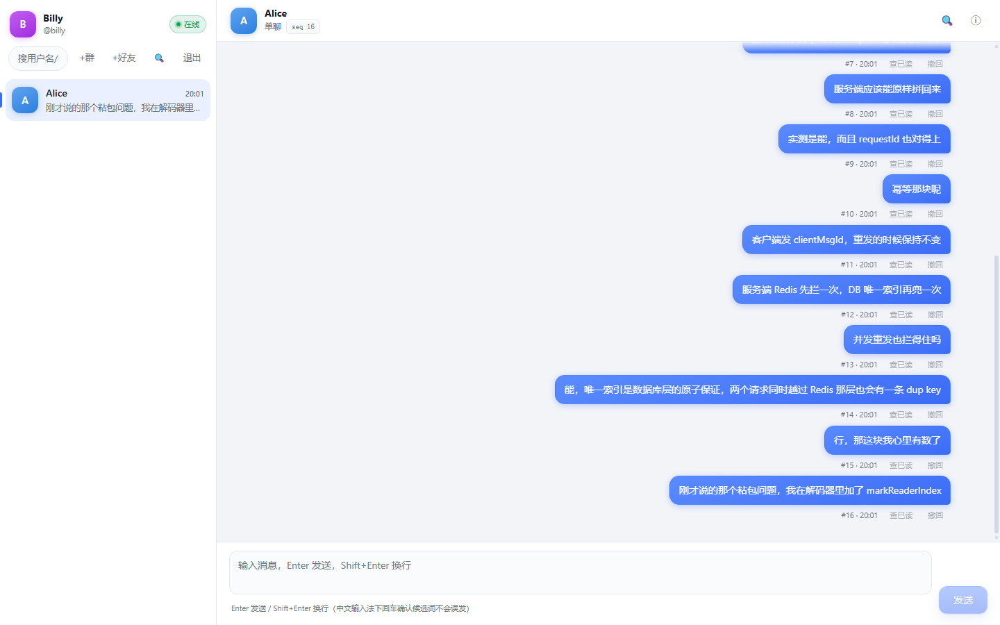

| 深色模式 | 会话信息 |
| --- | --- |
| 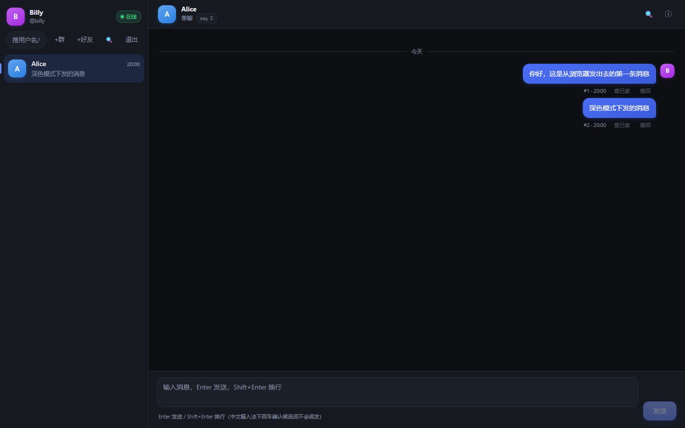 | 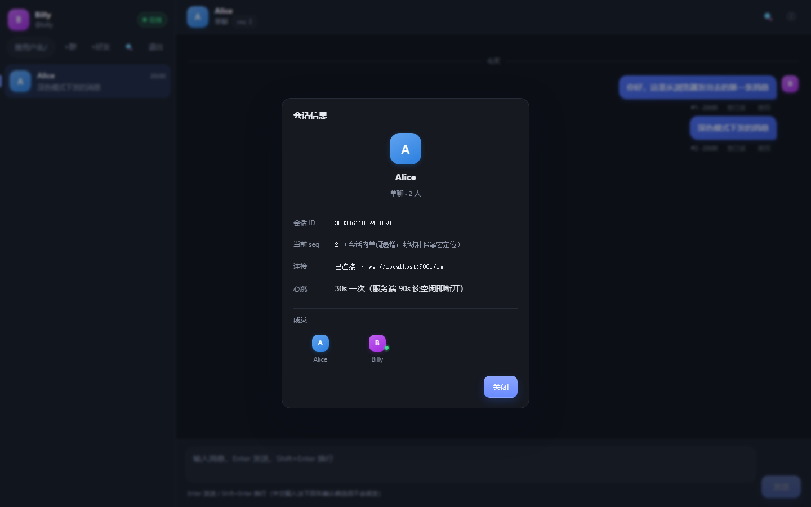 |

| 群成员管理 | 查找聊天记录 | 消息撤回 |
| --- | --- | --- |
| 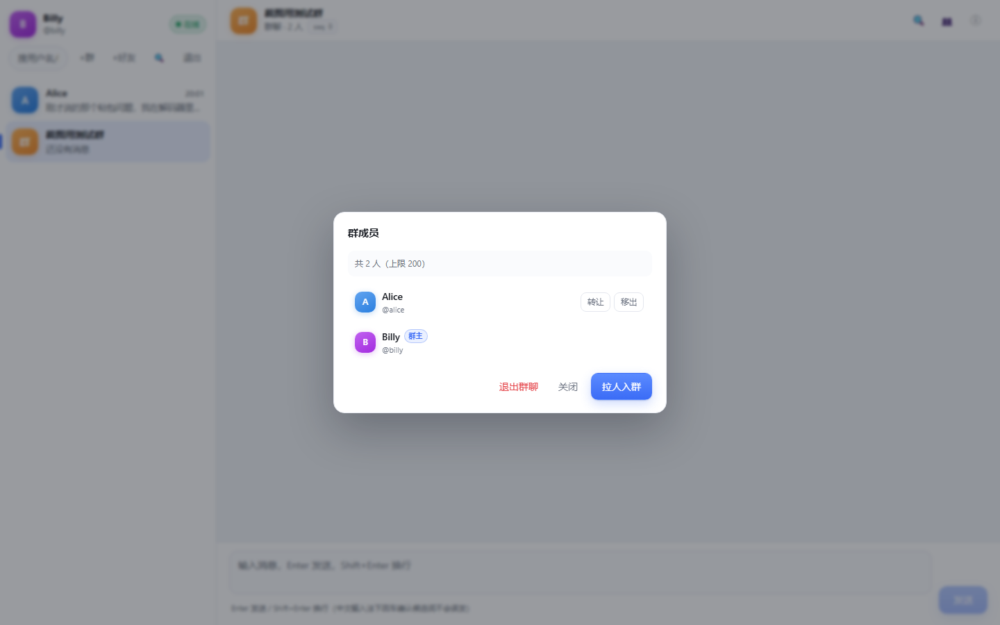 | 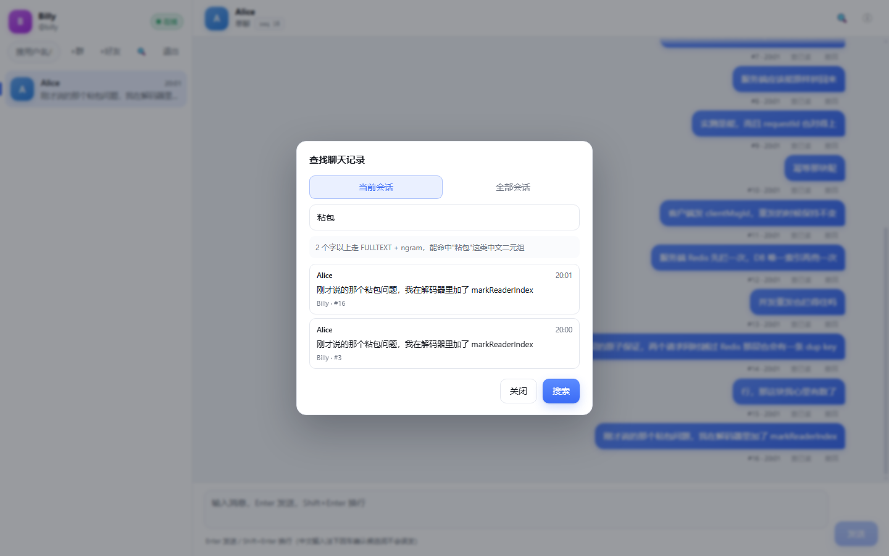 | 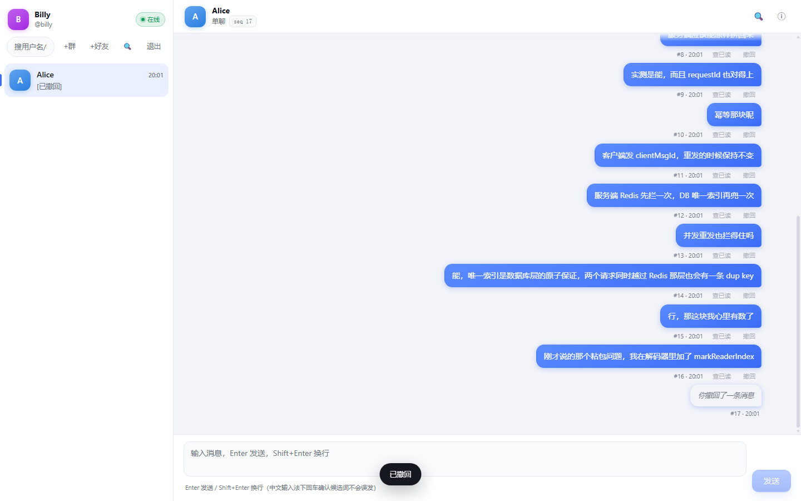 |

---

## 目录

- [1. 一分钟看懂它解决什么问题](#1-一分钟看懂它解决什么问题)
- [2. 快速运行](#2-快速运行)
- [3. 项目结构](#3-项目结构)
- [4. 通信协议](#4-通信协议)
- [5. 核心链路：一条消息的完整旅程](#5-核心链路一条消息的完整旅程)
- [6. 关键设计（面试讲解点）](#6-关键设计面试讲解点)
- [7. 性能实测](#7-性能实测)
- [8. 踩过的真实 bug](#8-踩过的真实-bug)
- [9. 验证与压测](#9-验证与压测)
- [10. 已知局限与多机扩展](#10-已知局限与多机扩展)
- [11. 怎么"真正掌握"这个项目](#11-怎么真正掌握这个项目)

---

## 1. 一分钟看懂它解决什么问题

普通 CRUD 项目发消息是"客户端 POST 一下、对方下次刷新能看到"。真实 IM 要难得多：

| 问题 | 现象 | 本项目的做法 |
| --- | --- | --- |
| **粘包/半包** | 两条消息粘在一起读；一条消息只读到一半 | 18 字节定长头带 `bodyLen`，`ByteToMessageDecoder` 累加缓冲区，不够就 `resetReaderIndex` 等下次 |
| **重复发送** | 网络超时客户端重发，对方收到两条一样的 | 客户端必须带 `clientMsgId`；Redis 幂等键（TTL 2h）+ DB 唯一索引 `uk_client_msg` 双保险 |
| **乱序** | 时间戳相同、两台机器时钟差几毫秒 | 会话内 `seq` 由 Redis `INCR` 统一发号，严格单调；客户端只按 seq 排序 |
| **丢消息** | 发的时候对方离线，消息没了 | 落库成功才回 ack；对方的 `delivered_seq` 记录"已收到哪条"，重连从这里续传 |
| **重复打扰** | 断线重连拉取时，把已经看过的又拉一遍 | `last_read_seq`（看过）与 `delivered_seq`（收到）分离，两个位点各管一件事 |
| **多端同步** | 手机上读了，电脑上还显示未读红点 | 已读位点上报后，服务端给**同账号其他端**推 `READ_SYNC_PUSH` |
| **大群写放大** | 1000 人群发一条 = 1000 次投递 | 按群规模分档：≤200 人写扩散，超过转读扩散（只发轻量通知，客户端自己拉） |
| **找人 / 找消息** | 想加的人得先搜索名字；上周聊过什么记不住 | 好友候选由后端 `NOT EXISTS` 一次算出；聊天记录走 MySQL `ngram` 全文索引（2 字以上），单字自动退回 `LIKE` |
| **撤回** | 发错了想撤回，删库却会让 seq 出现空洞 | 软删：`revoked` 标记 + `content` 在 VO 层置空；SQL 里带 `revoked = 0` 保证重复撤回不重复广播 |
| **已读回执** | "他到底看没看" | 不建每人每条矩阵表，用位点反推：`last_read_seq >= 目标 seq` 的人就是读过的人 |
| **群管理** | 拉人 / 踢人 / 转让群主，退了群还能不能看历史 | 成员软删 `left_at`（保住已读位点与重入能力），每句查成员 SQL 都带 `left_at IS NULL` |

---

## 2. 快速运行

### 2.1 前置环境

| 依赖 | 版本 | 说明 |
| --- | --- | --- |
| JDK | 21 | 项目用了 record、`switch` 模式匹配等 |
| Maven | 3.9+ | 只需联网拉一次依赖 |
| MySQL | 8.0 | 默认 `127.0.0.1:3306`，账号 `root` / `123456` |
| Redis | 5.0+ | 默认 `127.0.0.1:6379`，不要密码 |
| Node.js | 20+ | 只跑前端时需要 |

### 2.2 建库（只需一次）

```bash
"C:/Program Files/MySQL/MySQL Server 8.0/bin/mysql.exe" -uroot -p123456 \
  -e "CREATE DATABASE IF NOT EXISTS yujian_im DEFAULT CHARACTER SET utf8mb4 COLLATE utf8mb4_general_ci;"
```

建表不用管——`spring.sql.init.mode=always` 会在应用启动时自动执行 `backend/src/main/resources/db/schema.sql`（脚本里全是 `CREATE TABLE IF NOT EXISTS`，重复执行安全）。

### 2.3 启动 Redis

```bash
redis-server --port 6379 --save "" --appendonly no
```

`--save "" --appendonly no` 是关掉持久化：本项目 Redis 只存**可重建的**数据（seq 计数器能从 DB `max(seq)` 恢复、幂等键丢了最多多一次重复检查），关掉持久化能让压测数字更干净。

### 2.4 启动后端

```bash
cd backend
mvn -DskipTests package          # 产物 target/yujian-im.jar，约 47 MB

java -jar target/yujian-im.jar
```

启动成功的日志长这样：

```
Tomcat started on port 8080 (http)
Netty 启动完成: TCP=9000, WebSocket=9001, worker 线程数=56
指令分发器加载了 7 个处理器: [LOGIN_REQ, HEARTBEAT_REQ, SINGLE_CHAT_REQ, GROUP_CHAT_REQ, ACK_REQ, PULL_OFFLINE_REQ, READ_SYNC_REQ]
```

用 `curl` 验一下活：

```bash
curl -X POST http://127.0.0.1:8080/api/auth/register \
  -H "Content-Type: application/json" \
  -d '{"username":"alice","password":"123456","nickname":"Alice"}'
```

看到 `{"code":0,"msg":"ok","data":{"userId":"383...","token":"eyJ..."}}` 就通了。注意 `userId` 是**字符串**——原因见 [§8.1](#81-雪花-id-精度丢失浏览器把-936-读成-940)。

### 2.5 启动前端

```bash
cd frontend
npm install
npm run dev
```

打开 **http://localhost:5173**（不是 `127.0.0.1`，Vite 只监听 IPv6 的 `[::1]`）。

`vite.config.js` 里已配好 `/api` → `http://127.0.0.1:8080` 代理，所以前端代码里全用相对路径，后端不需要开 CORS。

注册两个账号（比如 billy 和 alice），互相搜到对方，点开单聊发一条消息——对方在另一个浏览器窗口里能实时收到。

**演示账号**（已建好，密码统一 `123456`）：`alice`、`billy`、`demo_zhang`、`demo_li`。登录页底部有快捷按钮，点一下自动填好。

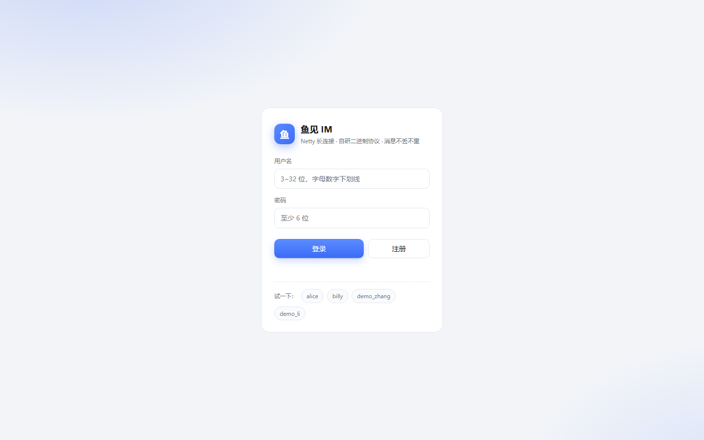


界面跟随系统深色模式自动切换（下面这张是同一个页面在深色下的样子）：


点标题栏右边的 ⓘ 可以看这个会话的成员、会话 ID、当前 seq 和连接状态——把平时只能靠日志确认的东西摊到界面上：


往上翻历史时会出现「回到底部」，滚动区上下边缘还有一层很淡的阴影提示"上面/下面还有内容"：

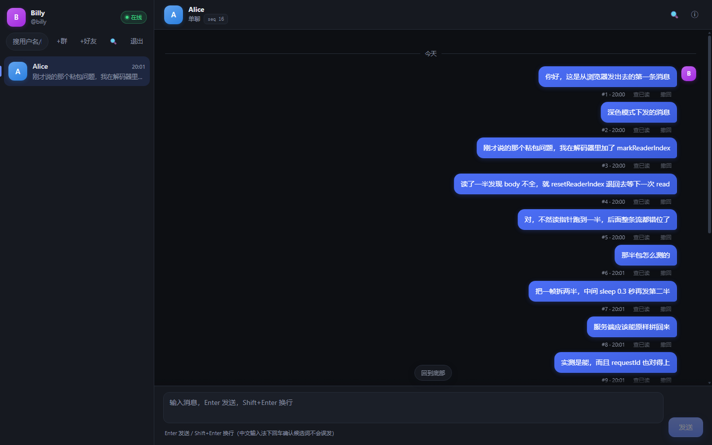

「添加好友」直接把**还没加过的人**列出来勾选，不用先搜索：

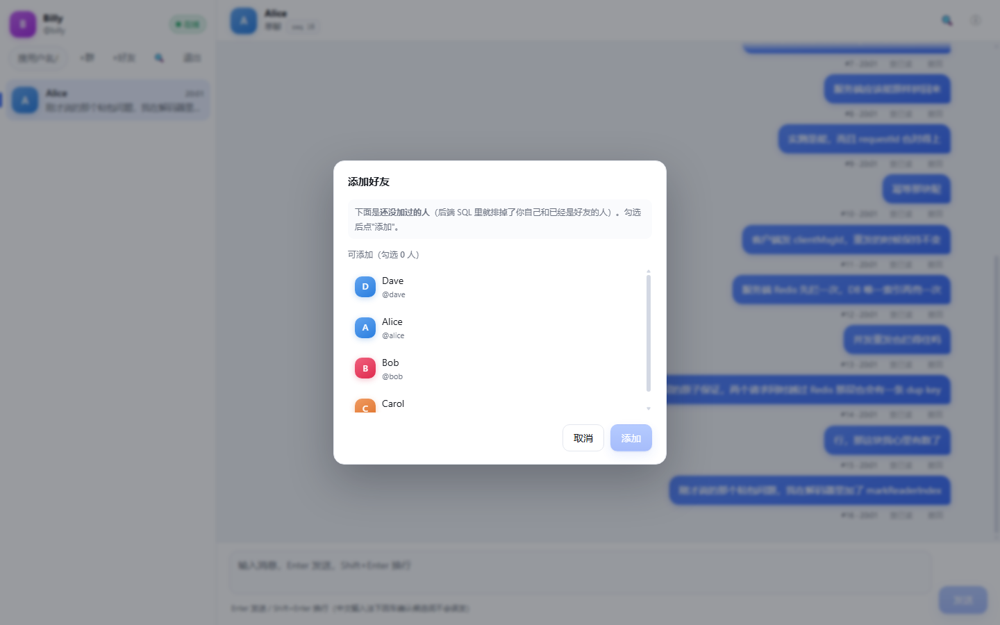

「查找聊天记录」可以限定当前会话或跨全部会话，点结果直接跳到那条消息并高亮：


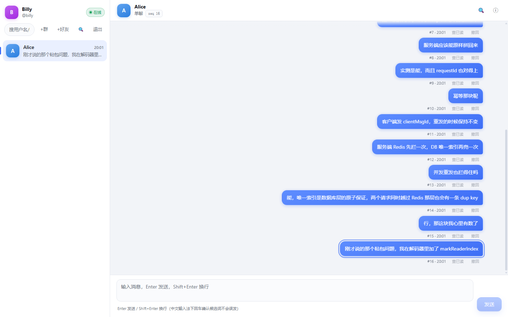

两分钟内自己发的消息可以撤回，撤回后气泡变成虚线占位（不是消失——消失会让 seq 出现空洞）：


自己发的消息点「查已读」看谁读了（群聊显示"N/M 人已读"）：

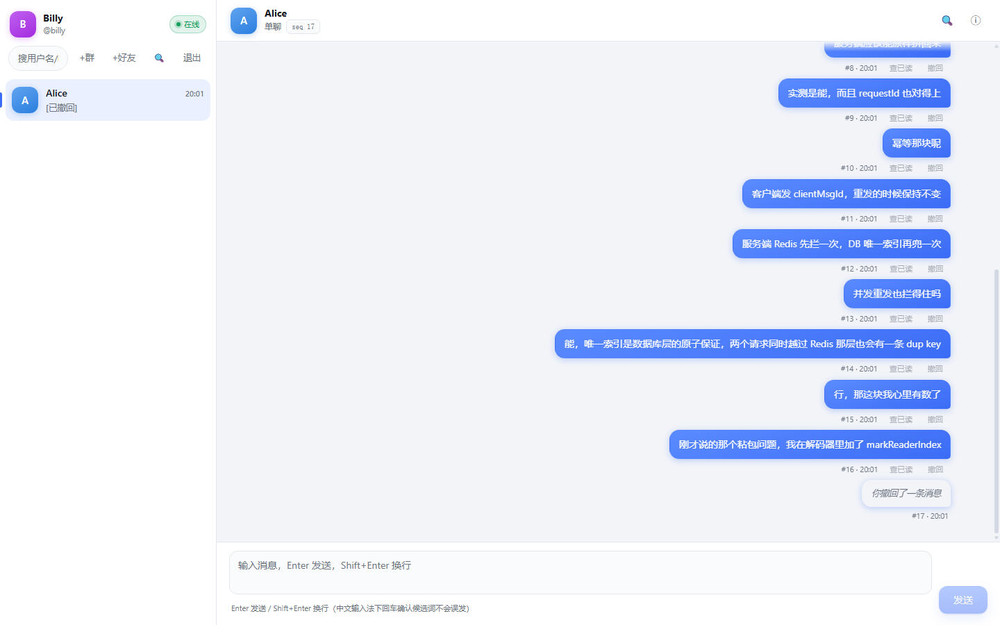

群聊标题栏的 👥 打开群成员管理：拉人、踢人、转让群主、退群：


#### 前端几个"为什么这么写"的决策

| 决策 | 做法 | 理由 |
|---|---|---|
| 深色模式 | `color-scheme: light dark` + `light-dark()` | 声明配色方案后，滚动条、输入框内部、`<dialog>` 的 backdrop 这些**原生 UI 浏览器自己就换掉了**，不用逐个控件重写。不支持 `light-dark()` 的老浏览器由 `@media (prefers-color-scheme: dark)` 兜底 |
| 输入框自动长高 | `field-sizing: content` | JS 方案每敲一个字都要读 `scrollHeight`（强制重排）+ 写 style（再重排）。一行 CSS 交给排版引擎，降级只是不长高 |
| 群聊弹窗 | 原生 `<dialog>` + `showModal()` | 自带 top-layer（永远在最高层，不会被父元素 `overflow` 裁掉）、ESC 关闭、焦点陷阱，不用算 z-index |
| 弹窗进出场 | `transition-property: opacity, transform, display, overlay` + `transition-behavior: allow-discrete` + `@starting-style` | `close()` 之后 `display` 会立刻变 `none`，普通 transition 根本没机会跑。把离散属性也列进过渡、并开 `allow-discrete`，浏览器才会等过渡结束再切。`transition-behavior` 单独一行写：老浏览器不认识这条只会丢掉这一行，不会让整条 transition 失效 |
| 消息进场动画 | 全部包在 `@media (prefers-reduced-motion: no-preference)` 里 | 默认静态、需要时才开动画；而不是先写死再 `animation: none` 关掉（那样容易漏掉 transition，对前庭敏感用户也不友好） |
| 滚动条 | `scrollbar-width/color` 与 `::-webkit-scrollbar` 两套都写 | 新标准属性只有一份；注意规范规定只要写了 `scrollbar-color`，该元素的 `::-webkit-scrollbar` 就失效，所以两套值必须一致 |
| 滚动边缘阴影 | `container-type: scroll-state` + `::before/::after` + `@container scroll-state(scrollable: block-start / block-end)` | 监听 `scroll` 事件的话，每帧都要读 `scrollHeight` 强制同步重排，而且跑在 JS 线程；scroll-state 容器查询在合成线程判定，滚动时零 JS 参与。**坑：flex column 里的伪元素默认 `flex-shrink: 1`，内容一溢出就被压成 0 高，必须显式 `flex: none`**（本项目实测：不加是 `0px`，加了是 `14px`） |
| 回到底部按钮 | `.msg-area` 设 `position: relative`，按钮 `position: absolute` 贴底 | 不用 `fixed`（手机上会被键盘盖住、也不跟输入框走），也不用 `sticky`（放在滚动容器内部会跟着内容一起滚走） |
| 头像颜色 | 用户名 hash 出色相 → `--av-hue` → `hsl()` 渐变 | 同一个人在任何会话、任何时间都是同一个颜色，不用后端存头像文件也能一眼分辨谁是谁；降级（没传 `--av-hue`）回落品牌色 |
| 消息分组 | 同人 + 5 分钟内 + 不跨天 → `.grouped`，隐藏头像（`visibility: hidden` 保住布局宽度） | 连发多条时不会一屏全是重复头像；用 `visibility` 而不是 `display: none`，气泡的水平位置才不会左右跳 |
| 会话信息面板 | 新增 `GET /api/conversations/{id}/member-infos`，一次 `IN` 查询返回成员昵称 + 在线状态 | 原 `/members` 只回 id 列表，前端拿不到昵称；用 `/api/users/search` 逐个查会退化成 N 次模糊搜索。批量查是会话列表早就用的同一套 `mapByIds` |
| 中文输入法回车 | `e.isComposing \|\| e.keyCode === 229` 时直接 return | 拼音输入时按回车是"确认候选词"，不拦就会把半截拼音发出去。229 是为了兜 Safari 的事件顺序 bug |
| 好友候选列表 | 后端 `NOT EXISTS` 算好"还没加的人"，前端只渲染 | 前端做差集的话，得先把整张用户表拉到浏览器再过滤。用户一多就是几 MB JSON + 一次无谓的 O(n·m) 比较。**用 `NOT EXISTS` 而不是 `NOT IN`**：子查询里一旦出现 NULL，`NOT IN` 会整体返回空集，而且 `NOT EXISTS` 能走 semi-join |
| 搜索命中后跳转 | 先打开会话，再按 `messages[0].seq > hit.seq` 向上翻最多 5 页，`scrollIntoView({block:'center'})` 定位 | 目标消息可能在第一页之前的历史里。翻不到就明说"请手动向上翻"，不假装成功——点了没反应比明确提示更糟 |
| 搜索高亮 | `.msg-row.hl .bubble { animation: hl-flash 2.4s }`，用 `outline` 不用 `background` | `outline` 画在 border 外，不影响气泡自身的配色（深色模式下气泡是半透明的，改背景会跟其它气泡不一致）；动画放 `@media (prefers-reduced-motion)` 里可关 |
| 撤回按钮 | 只在 `canRevoke(m)` 为真时渲染（自己发的 + 2 分钟内 + 未撤回） | 服务端一定会再校验一次（防改客户端），但本地先藏起来，用户就不会点了个必然失败的按钮 |
| 撤回态气泡 | `.bubble.revoked`：透明底 + 虚线边框 + 斜体弱色 | 撤回不是"内容为空的普通消息"，视觉上要读成"这里曾经有过东西，现在没了"。实心气泡会让人以为对方真发了空消息 |
| 查已读/撤回按钮位置 | 塞进 `.msg-meta` 行，默认 `opacity: .55`，hover 整行才变实 | 一屏 20 条消息，如果这些次要操作都实心可见，聊天区会被按钮噪音填满 |
| 群成员管理 | 走 HTTP 不走长连接 | 低频操作 + 需要明确的失败原因（"群主不能直接退群"）。HTTP 的错误体天然适合表达这个；长连接只留给高频的消息流 |
| 群成员弹窗宽度 | 480px（比默认 400px 宽） | 一行要放"头像 + 昵称 + @handle + 群主标签 + 转让/移出两个按钮"，400px 会挤成两行 |

---

## 3. 项目结构

```
yujian-im/
├── README.md
├── backend/                                  Spring Boot 3.3.5 + Netty 4.1
│   ├── pom.xml
│   └── src/main/
│       ├── java/com/yujian/im/
│       │   ├── YuJianImApplication.java      启动类
│       │   │
│       │   ├── protocol/                     ★ 自研二进制协议
│       │   │   ├── ProtocolConst.java        魔数 0xCAFE、头长 18、body 上限 8MB
│       │   │   ├── Command.java              命令字枚举（1 字节）
│       │   │   ├── ImMessage.java            解码后的内存载体
│       │   │   ├── ImDecoder.java            ★ 解粘包半包（ByteToMessageDecoder）
│       │   │   ├── ImEncoder.java            编码（MessageToByteEncoder）
│       │   │   ├── BodyCodec.java            JSON body 编解码（自带 ObjectMapper）
│       │   │   └── dto/                      各命令的请求/响应体
│       │   │
│       │   ├── netty/                        ★ 网络层
│       │   │   ├── NettyServer.java          双端口装配，ApplicationReadyEvent 启动
│       │   │   ├── TcpChannelInitializer.java    TCP pipeline
│       │   │   ├── WsChannelInitializer.java     WebSocket pipeline
│       │   │   ├── WsCodec.java              JSON 信封 ↔ ImMessage
│       │   │   ├── IdleCloseHandler.java     读空闲超时断开
│       │   │   ├── ImResponses.java          统一回包工具（务必透传 requestId）
│       │   │   └── handler/                  ★ 业务处理器
│       │   │       ├── ImDispatcher.java     限流 → 鉴权 → 按命令字分发
│       │   │       ├── CommandHandler.java   处理器接口
│       │   │       ├── TokenBucket.java      单连接令牌桶限流
│       │   │       ├── LoginHandler.java     长连接上做身份绑定
│       │   │       ├── HeartbeatHandler.java
│       │   │       ├── AbstractChatHandler.java  单聊/群聊共用骨架 + 耗时埋点
│       │   │       ├── SingleChatHandler.java
│       │   │       ├── GroupChatHandler.java
│       │   │       ├── AckHandler.java       推进 delivered_seq，不回包
│       │   │       ├── PullOfflineHandler.java
│       │   │       ├── ReadSyncHandler.java  多端已读同步 + 触发已读回执
│       │   │       ├── RevokeHandler.java    撤回请求
│       │   │       └── ReadReceiptHandler.java  查某条消息谁读了
│       │   │
│       │   ├── session/SessionRegistry.java  ★ userId → 多 Channel（多端在线）
│       │   ├── push/PushService.java         ★ 写扩散/读扩散、未读数、跨端已读/撤回/群事件推送
│       │   │
│       │   ├── message/                      ★ 不丢不重不乱序的实现地
│       │   │   ├── Message.java
│       │   │   ├── MessageMapper.java
│       │   │   ├── MessageService.java       send / history / pullOffline / ack
│       │   │   └── RevokeService.java        ★ 撤回：时间窗校验 + 软删 + 重算预览
│       │   ├── read/ReadReceiptService.java  ★ 已读回执：位点法反推谁读过
│       │   ├── conversation/
│       │   │   ├── Conversation.java
│       │   │   ├── ConversationMember.java
│       │   │   ├── ConversationMapper.java
│       │   │   ├── ConversationMemberMapper.java  ★ 每句 SQL 都带 left_at IS NULL
│       │   │   ├── ConversationSeqService.java  ★ Redis INCR 发号 + SETNX 冷启动
│       │   │   ├── ConversationService.java    建会话（pair_key 唯一）/ 列表 / 未读
│       │   │   └── GroupService.java         ★ 拉人/退群/踢人/转让群主
│       │   ├── user/                         User / UserMapper / UserService(BCrypt)
│       │   ├── friend/                       ★ 好友关系（单向存两行）
│       │   │   ├── Friend.java               为什么一行只存一个方向
│       │   │   ├── FriendMapper.java         NOT EXISTS 算"还没加的人"
│       │   │   └── FriendService.java        加/删/候选，DuplicateKey 兜幂等
│       │   ├── search/                       ★ 聊天记录搜索
│       │   │   ├── SearchHit.java            比 MessageVO 多会话标题
│       │   │   └── SearchService.java        全文索引 vs LIKE 分流 + 权限边界
│       │   ├── auth/                         JwtService / TokenBlacklist / 拦截器 / @CurrentUser
│       │   ├── controller/                   Auth / Conversation / User / Friend / Search / Group
│       │   ├── common/                       R / BizException / 全局异常 / Snowflake / RedisKeys / JsonModules
│       │   └── config/                       IdConfig / JacksonConfig / WebConfig / SchemaUpgrade
│       └── resources/
│           ├── application.yml
│           └── db/schema.sql                 5 张表，唯一索引就是最后一道闸门
│
├── frontend/                                 Vue 3 + Vite 6
│   ├── vite.config.js                        /api 代理到 8080
│   ├── index.html
│   └── src/
│       ├── main.js
│       ├── App.vue                           ★ 登录 + 双栏聊天，乐观发送 / 补洞 / 未读 / 撤回 / 回执 / 群管理
│       ├── api.js                            HTTP 封装，统一带 Bearer token
│       ├── ws.js                             ★ WebSocket 客户端：requestId 关联、心跳、指数退避重连
│       └── styles.css                        CSS 变量主题 / field-sizing / scroll-state 阴影 / 原生 dialog
│
├── tools/
│   ├── loadtest/                             ★ Netty 压测客户端（独立第二份协议实现）
│   │   └── src/main/java/com/yujian/im/loadtest/LoadTest.java
│   └── verify/                               ★ Python 协议一致性验证
│       ├── im_client.py                      手写 18 字节头的 TCP 客户端
│       ├── t_http.py                         HTTP 接口冒烟
│       ├── t_im.py                           27 项 TCP 断言（粘包/半包/幂等/离线/群聊…）
│       ├── t_ws.py                           手写 WebSocket 握手
│       ├── t_ws_flow.py                      24 项断言，前端 ws.js 的等价实现
│       ├── t_friend_search.py                23 项好友/搜索断言（ngram 单字/短语/越权）
│       ├── t_revoke_read_group.py            57 项撤回/已读回执/群管理断言
│       ├── t_e2e_live.py                     28 项端到端断言（四端在线、多端已读同步）
│       ├── im_ws.py                          极简 WS 客户端（上述脚本共用）
│       ├── shot_ui.py                        CDP 驱动 headless Edge 截图 + UI 断言
│       └── reset.py                          清库（MySQL TRUNCATE + Redis FLUSHDB）
│
└── _shots/                                   17 张 README 截图（登录/浅色/深色/群聊/信息面板/回到底部/好友/搜索跳转/撤回/已读/群成员）
```

### 3.1 HTTP 接口一览

长连接只负责"服务端要主动推"的事，剩下的一问一答全走 HTTP——这样能吃到 HTTP 的缓存、压缩、网关限流，也不会占用 EventLoop 线程。

| 方法 | 路径 | 说明 |
|---|---|---|
| POST | `/api/auth/register` | 注册，直接返回 token |
| POST | `/api/auth/login` | 登录，返回 token / userId / wsPath / wsPort |
| POST | `/api/auth/logout` | 把 token 剩余有效期写进 Redis 黑名单 |
| GET | `/api/users/me` | 当前用户信息 |
| GET | `/api/users/search?keyword=` | 按用户名/昵称搜人，带在线状态 |
| GET | `/api/users/online-stats` | 当前在线用户数 / 连接数 |
| GET | `/api/conversations` | 我的会话列表（带未读数、最后一条预览） |
| POST | `/api/conversations/single` | 建单聊，body `{targetUserId}`，靠 `pair_key` 唯一索引保证幂等 |
| POST | `/api/conversations/group` | 建群，body `{name, memberIds}`，2~200 人 |
| GET | `/api/conversations/{convId}/messages?beforeSeq=&limit=` | 历史消息，倒序查完 reverse 成正序返回 |
| POST | `/api/conversations/{convId}/read?seq=` | 标记已读到某条 |
| GET | `/api/conversations/{convId}/members` | 成员 id 列表（轻量） |
| GET | `/api/conversations/{convId}/member-infos` | 成员 id + 昵称 + 在线状态（一次 `IN` 查询，信息面板用） |
| GET | `/api/conversations/{convId}/group-members` | 群成员详情（带 role / joinedAt），群管理面板用 |
| POST | `/api/conversations/{convId}/members` | 拉人入群，body `{memberIds}`；返回**实际新加入**的人（已在群里的被过滤） |
| DELETE | `/api/conversations/{convId}/members/me` | 退群；群主直接退会被拒，要求先转让 |
| DELETE | `/api/conversations/{convId}/members/{targetId}` | 踢人，**仅群主** |
| POST | `/api/conversations/{convId}/transfer?targetId=` | 转让群主，**仅群主** |
| GET | `/api/friends` | 我的好友列表（带在线状态） |
| GET | `/api/friends/candidates?limit=` | **还没加过的人**，SQL 里用 `NOT EXISTS` 排除自己与已有好友 |
| POST | `/api/friends` | 加好友，body `{targetId}`；双向各插一行，靠唯一索引天然幂等 |
| DELETE | `/api/friends?targetId=` | 删好友，双向删，幂等 |
| GET | `/api/search/messages?keyword=&conversationId=&limit=` | 搜聊天记录。`conversationId` 不传=全局搜；非成员会被 403 |
| GET | `/actuator/prometheus` | 指标暴露 |

> 所有 ID 字段（用户、会话、消息 ID）都是 **JSON 字符串**，`seq` 是 JSON 数字——原因见 §8.1。

---

## 4. 通信协议

### 4.1 帧格式（18 字节定长头 + 变长 body）

全部**大端序**（网络字节序）。

| 偏移 | 长度 | 字段 | 说明 |
| --- | --- | --- | --- |
| 0 | 2 | `magic` | 固定 `0xCAFE`。对不上说明字节流错位，直接断连 |
| 2 | 1 | `version` | 当前 `1`，为将来协议升级留位 |
| 3 | 1 | `command` | 命令字，见下表 |
| 4 | 1 | `serialize` | `0` = JSON（留着以后接 Protobuf） |
| 5 | 1 | `status` | `0` 成功，非 0 业务错误码 |
| 6 | 8 | `requestId` | **客户端生成，服务端原样回传**，用于请求-响应关联 |
| 14 | 4 | `bodyLen` | body 字节数，上限 8 MB（防对端用巨大 length 撑爆内存） |
| 18 | `bodyLen` | `body` | UTF-8 JSON |

为什么是"定长头 + 变长体"：定长头让解码器可以**只看前 18 字节**就知道整条消息多长，不用猜分隔符；变长体不浪费空间。这也是几乎所有二进制协议（Dubbo、Kafka、MySQL 内部协议）的共同做法。

### 4.2 命令字

| 值 | 命令 | 方向 | body |
| --- | --- | --- | --- |
| `0x01` | `LOGIN_REQ` | C→S | `{token, device}` |
| `0x02` | `LOGIN_RESP` | S→C | `{success, userId, message, serverTime}` |
| `0x03` | `HEARTBEAT_REQ` | C→S | `{}` |
| `0x04` | `HEARTBEAT_RESP` | S→C | `{serverTime}` |
| `0x05` | `SINGLE_CHAT_REQ` | C→S | `{conversationId, type, content, clientMsgId}` |
| `0x06` | `SINGLE_CHAT_RESP` | S→C | `MessageVO` |
| `0x07` | `GROUP_CHAT_REQ` | C→S | 同上 |
| `0x08` | `GROUP_CHAT_RESP` | S→C | `MessageVO` |
| `0x09` | `PUSH_MESSAGE` | S→C | `MessageVO`（新消息到达） |
| `0x0A` | `ACK_REQ` | C→S | `{conversationId, seq, msgId}`，**服务端不回包** |
| `0x0B` | `ACK_RESP` | — | 预留 |
| `0x0C` | `PULL_OFFLINE_REQ` | C→S | `{conversationId, afterSeq, limit}` |
| `0x0D` | `PULL_OFFLINE_RESP` | S→C | `MessageVO[]` |
| `0x0E` | `READ_SYNC_PUSH` | S→C | `{conversationId, lastReadSeq}` |
| `0x0F` | `KICK_PUSH` | S→C | 被踢下线（预留） |
| `0x10` | `READ_SYNC_REQ` | C→S | `{conversationId, seq}` |
| `0x11` | `REVOKE_REQ` | C→S | `{conversationId, msgId}` |
| `0x12` | `REVOKE_RESP` | S→C | `MessageVO`（`revoked:true`，`content` 已置空） |
| `0x13` | `REVOKE_PUSH` | S→C | `{conversationId, msgId, seq, operatorId, revokedAt}` |
| `0x14` | `READ_RECEIPT_REQ` | C→S | `{conversationId, msgId}` |
| `0x15` | `READ_RECEIPT_RESP` | S→C | `ReadReceiptVO` |
| `0x16` | `READ_RECEIPT_PUSH` | S→C | `ReadReceiptVO`（只推给发送者） |
| `0x17` | `GROUP_EVENT_PUSH` | S→C | `{conversationId, event, targetUserId, operatorId, memberCount}` |
| `0x7F` | `ERROR` | S→C | `{code, msg}` |

> 撤回为什么不复用 `PUSH_MESSAGE`：新消息到达和老消息状态变了是两类事件，混一个命令字里客户端就得在 handler 里 `if (type === 'revoke')` 分叉，以后每加一种状态（编辑、删除、置顶）都要改这条路径。多给一个命令字，客户端只是多注册一行回调。

`MessageVO` 的字段：

```json
{
  "msgId": "383200368705798144",
  "conversationId": "383200197536251904",
  "seq": 1,
  "fromUserId": "383200195560734720",
  "fromNickname": "Alice",
  "type": 1,
  "content": "你好",
  "createdAt": "2026-11-23 10:21:05",
  "clientMsgId": "c-1a2b3c",
  "duplicate": false,
  "revoked": false,
  "revokedAt": null
}
```

`ReadReceiptVO`：

```json
{
  "conversationId": "383200197536251904",
  "msgId": "383200368705798144",
  "seq": 7,
  "readUserIds": ["383200195560734721"],
  "unreadUserIds": [],
  "totalOthers": 1
}
```

**注意类型**：ID 类字段是**字符串**，`seq` 是**数字**。这条规则看着别扭，但它是踩坑换来的（见 §8.1）。

### 4.3 WebSocket 的信封

浏览器拿不到裸 TCP，所以 9001 端口走 WebSocket，但**业务语义与 TCP 完全一致**，只是把 18 字节头换成 JSON 信封：

```json
{"cmd": 5, "status": 0, "requestId": 42, "body": {"conversationId": "...", "content": "hi", "clientMsgId": "c-1"}}
```

两条通道的差异被 `WsCodec.Decoder` / `WsCodec.Encoder` 完全吸收，复用同一个 `ImMessage` 载体和同一批 `CommandHandler`。**新增一个命令只需要写一个 Handler，两条通道自动都有。**

### 4.4 Pipeline 对比

```
TCP  (9000):
  IdleStateHandler(90s 读空闲) → IdleCloseHandler → ImDecoder → ImEncoder → ImDispatcher

WS   (9001):
  HttpServerCodec → HttpObjectAggregator → ChunkedWriteHandler
  → IdleStateHandler → IdleCloseHandler
  → WebSocketServerProtocolHandler("/im")
  → WsCodec.Decoder → WsCodec.Encoder → ImDispatcher
```

---

## 5. 核心链路：一条消息的完整旅程

### 5.1 发送（`MessageService.send`，6 步）

```
1. assertMember(convId, fromUserId)       —— 不是成员直接拒，防越权
2. findDuplicate(fromUserId, clientMsgId) —— Redis 幂等键命中就返回旧 VO，标 duplicate=true
3. seq = seqService.nextSeq(convId)       —— Redis INCR，会话内严格单调
4. messageMapper.insert(msg)              —— 捕获 DuplicateKeyException 回查（并发重发的兜底）
5. conversationService.updateLastMessage  —— 会话列表的摘要与排序键
6. 写 Redis 幂等键（TTL 2h）
```

然后 **Handler 在事务提交之后**才调 `messageService.push(vo, fromUserId)` 做投递。

> 为什么推送不写在事务里？因为接收方收到推送后可能立刻回拉历史，而那时事务还没提交，**他会查不到这条消息**——这就是"推了但拉不到"的幽灵 bug。

### 5.2 投递（`PushService.pushToConversation`）

```
取会话成员 userId 列表
  ├─ 成员数 <= 200：写扩散
  │    对每个成员，SessionRegistry 找到他所有在线 Channel，逐个 writeAndFlush
  │    在线 → im_push_total{result=sent}++，离线 → {result=offline}++ 并 bumpUnread
  └─ 成员数 > 200：读扩散
       只给在线成员发一条轻量"有新消息"通知，客户端凭 seq 自己拉
```

注意：**发送方自己也在这条推送链里**，所以他会收到自己刚发的消息。这不是 bug，是**多端同步的必然结果**——他在手机、电脑、网页上都要看到这条消息。客户端靠 `msgId` / `clientMsgId` 去重即可（`App.vue` 的 `onPush` 就是这么做的）。

### 5.3 接收与确认（客户端视角）

```
收到 PUSH_MESSAGE
  → 按 msgId 去重（可能是重复推送）
  → 按 seq 插入到正确位置（seq 可能有洞，不要假设连续）
  → 立刻发 ACK_REQ  ← 关键：告诉服务端"我收到了"，推进 delivered_seq
  → 如果正在看这个会话，再发 READ_SYNC_REQ 推进 last_read_seq
```

### 5.4 断线重连（`PullOfflineHandler`）

```
客户端：本地有会话的最大 seq = 100，但 delivered_seq 只到 97
  → 发 PULL_OFFLINE_REQ {conversationId, afterSeq: 97, limit: 200}
服务端：SELECT ... WHERE conversation_id=? AND seq > 97 ORDER BY seq LIMIT 200
  → 回 98、99、100 三条
```

- 起点用 **`delivered_seq`（客户端确认收到）**，不是 `last_read_seq`（用户看过）。用错的话，用户没看的消息会被当成已送达而永久丢失。
- `limit` 有上限（默认 200），防止掉线三天的用户一次拉十万条把内存打爆。拉完还有剩余就再拉一轮。

---

## 6. 关键设计（面试讲解点）

### 6.1 粘包 / 半包：为什么不能靠"读一次就是一条"

TCP 是**字节流**，没有消息边界。客户端连发两条 100 字节的消息，服务端一次 `read` 可能收到 200 字节（粘包），也可能只收到 60 字节（半包）。大数据包几乎必然出现半包。

`ImDecoder` 的做法（`protocol/ImDecoder.java`）：

```java
if (in.readableBytes() < HEADER_LENGTH) return;      // 头都没收全，等
in.markReaderIndex();                                 // 记住这条消息的起点
// ... 读头，拿到 bodyLength ...
if (in.readableBytes() < bodyLength) {
    in.resetReaderIndex();                            // 读指针退回起点
    return;                                           // 等下一次 read 累积
}
// 解出一条，out.add(...)
// 外层 ByteToMessageDecoder 会循环调 decode，一次 read 里的多条消息全被拆出来
```

三个细节：
1. **`markReaderIndex` / `resetReaderIndex` 是半包的关键**。读了一半发现 body 不全，必须把指针退回消息开头，否则下次读到的就是错位的字节。
2. **`ByteToMessageDecoder` 自带 cumulation 缓冲区**，会把没消费完的字节留着和下一次的字节拼起来。所以"半包"对它来说是天然支持的，我们只需要正确处理"本次不够"这个分支。
3. **必须校验 `bodyLength` 上限**。长连接是公网暴露面，对端发一个 `bodyLen = 2GB` 就能让你 OOM。这里是 8 MB，超了抛 `TooLongFrameException` 直接断连。

验证方式：`tools/verify/t_im.py` 的第 4、5 组用例——一次性 `sendall` 三帧（要求 requestId 不串号、seq 连续），以及把一帧拆成两半间隔 0.3s 发（要求正确重组）。

### 6.2 幂等：为什么"重发去重"必须由客户端配合

网络超时的时候，客户端**不知道**消息到底到了没有。它只能重发。如果服务端不处理，对方就收到两条一模一样的话。

关键认知：**服务端无法自己判断两条消息是不是同一条**——它们的内容、发送者、时间戳可能完全一样，也可能真的是用户连发两遍"哈哈"。所以必须由客户端生成一个 `clientMsgId`（通常是 UUID），重发时保持不变。

`MessageService` 的三层防线：

| 层 | 手段 | 拦什么 |
| --- | --- | --- |
| 1 | Redis key `im:msg:idem:{fromUserId}:{clientMsgId}`，TTL 2h | 绝大多数重发（O(1) 命中，不碰 DB） |
| 2 | DB 唯一索引 `uk_client_msg(from_user_id, client_msg_id)` | 并发重发（两个请求同时越过第 1 层） |
| 3 | 捕获 `DuplicateKeyException` 后回查并返回旧记录 | 让客户端看到"成功"而不是报错 |

第 2 层为什么必须有？因为第 1 层是 **check-then-act**：两个请求可能同时查 Redis 都返回"不存在"，然后都往下走。唯一索引是数据库层的原子保证，是最后一道闸门。

返回时把 `duplicate` 标成 `true`，但 `msgId` 与第一次相同——客户端据此知道"这条我已经发过了"，不会重复上屏。

### 6.3 seq 发号：为什么不用数据库自增

**问题**：同一毫秒内多条消息，时间戳相同，客户端排序会抖。需要会话内严格单调的整数。

**为什么不用 `UPDATE conversation SET seq = seq + 1` 再 `SELECT`**：同一个热门群聊的所有消息都要在这一行上排队拿行锁，串行化后吞吐直接砍半。

**为什么用 Redis `INCR`**：单线程原子操作，一次往返（同机房 <1ms），不需要锁任何行；落库退化成普通 INSERT。

```java
public long nextSeq(Long conversationId) {
    String key = RedisKeys.convSeq(conversationId);
    if (Boolean.FALSE.equals(redis.hasKey(key))) {
        initFromDb(conversationId, key);   // 冷启动：从 DB max(seq) 初始化
    }
    return redis.opsForValue().increment(key);
}
```

**代价（面试要主动说）**：Redis 发号成功但 DB 插入失败，这个 seq 就成了空号，消息序列里出现**洞**。

我们的选择是**允许洞**：客户端发现 seq 不连续时，按区间回拉一次补齐。要"绝对连续"就得在 Redis 和 MySQL 之间做两阶段提交，复杂度和收益完全不匹配——所有主流 IM 都是允许洞的。

**冷启动的坑**：Redis 重启后 key 没了，`INCR` 会从 1 开始，新消息的 seq 就和历史消息撞车，直接违反 `uk_conv_seq` 唯一索引。所以要先从 DB 的 `max(seq)` 初始化。用 `SETNX` 而不是 `SET`，是为了并发时只有一个线程真正去查库，且不会把已经涨上去的计数器覆盖回旧值。

### 6.4 已读与已收：为什么要两个位点

`im_conversation_member` 表里有两个字段：

| 字段 | 含义 | 谁推进 | 用途 |
| --- | --- | --- | --- |
| `last_read_seq` | 用户**看过**到哪 | 客户端上报（打开会话、滚动到底） | 算未读数：`未读 = 会话 seq - last_read_seq` |
| `delivered_seq` | 客户端**确认收到**到哪 | 收到推送后发 ACK | 断线重连续传的起点 |

**只用一个会怎样**：
- 只用 `last_read_seq` 续传 → 用户没点开的会话，消息会被当成"已送达"，永远不会再推 → **丢消息**。
- 只用 `delivered_seq` 算未读 → 手机在后台静默收了一堆消息，`delivered_seq` 涨上去了，但用户没看，红点却消失了 → **未读数错**。

两个位点各管一件事，这是"不丢"和"未读准确"能同时成立的前提。

`AckHandler` 还有个细节：**收到 ACK 后不回任何包**。因为 ACK 是纯上行的高频消息，每发一条消息就产生一个 ACK，如果还要回一个 ACK_RESP，出站流量直接翻倍，而客户端根本不需要这个响应。

### 6.5 多端同步：同账号多条连接

`SessionRegistry` 的结构是 `Map<Long, Set<Channel>>`——一个 userId 对应**多条**连接，因为同一个账号可能在手机、电脑、网页同时在线。

三个并发细节：

```java
// 1. computeIfAbsent 而不是 if (get == null) put
//    后者在并发下会互相覆盖，丢掉别人的连接（经典 check-then-act 竞态）
userChannels.computeIfAbsent(userId, k -> ConcurrentHashMap.newKeySet()).add(channel);

// 2. 用 remove(key, value) 而不是 remove(key)
//    如果这两步之间有新连接进来，computeIfAbsent 建了新 Set，这里就不该删
userChannels.remove(userId, set);

// 3. 内层用 ConcurrentHashMap.newKeySet()，不用 Collections.synchronizedMap
//    后者的读也要抢同一把锁，而推送是"读多"路径，会被拖死
```

多端同步的完整闭环：

```
手机打开会话 → READ_SYNC_REQ {convId, seq: 100}
  → 服务端 markRead(convId, userId, 100)      // DB last_read_seq = 100
  → clearUnread(userId, convId)                // Redis 未读数清零
  → 给同账号的**其他** Channel 推 READ_SYNC_PUSH {convId, lastReadSeq: 100}
     （用 `except` 参数跳过发起端自己）
电脑收到 READ_SYNC_PUSH → 清掉红点，把已读位置标到 100
```

`PushService.pushReadSync(userId, convId, seq, except)` 的 `except` 参数就是干这个的——**只推给其他端，不推回给发起端**。

### 6.6 好友关系：为什么一行只存一个方向

`im_friend` 是 `(id, owner_id, friend_id)`，加好友时插**两行**。

如果按"一行存两个人"（`user_a, user_b`，永远 `user_a < user_b`）来设计，查"我的好友"就得写 `where user_a = ? or user_b = ?` —— `or` 跨两列，索引只能用到一半，数据量一大就退化成扫描。单向存储之后：

```sql
-- 我的好友列表：一次索引扫描，命中 uk_owner_friend 的最左前缀
select friend_id from im_friend where owner_id = ?
```

代价是**写放大**（加一次好友写两行），但这个比值很划算：好友列表是每次打开 App 都读的热路径，加好友一天可能就几次。另外，将来要加"备注名""免打扰""消息置顶"这些**每人一份**的属性时，单向表天然有地方放；一行存两人的话，这些字段就得复制成两份 `remark_a` / `remark_b`。

加好友的幂等靠唯一索引 `uk_owner_friend (owner_id, friend_id)` 兜底 —— 整个 `add()` 包在事务里，捕获 `DuplicateKeyException` 当成"已经加过了"直接返回成功，不用先 `select` 再 `insert`（那样在并发下必然漏判）。

### 6.7 聊天记录搜索：ngram 分词器的三个坑

`im_message` 上加了 `FULLTEXT KEY ft_content (content) WITH PARSER ngram`。

`ngram` 是 **MySQL 内置的中文分词器**，不需要装 IK / jieba 插件（这是很多教程没说的——`WITH PARSER ngram` 就是官方给的答案）。它按二元组切词，`ngram_token_size` 默认 2。

实测出来的三个坑（都是真实跑过才发现的）：

**坑 1：单字永远搜不到。** `ngram_token_size = 2` 意味着索引里只有"粘包""半包"这样的二元组，没有"包"。`AGAINST('"包"')` 返回 0 条，而 `LIKE '%包%'` 返回 7 条。这不是 bug 是分词器语义。所以 `SearchService` 里按关键字长度分流：

```java
if (keyword.length() >= 2) { 走 FULLTEXT } else { 走 LIKE }
```

**坑 2：不加引号就不是短语匹配。** `AGAINST('粘包和半包' IN BOOLEAN MODE)` 会被拆成几个 token，只要命中**任意一个**就返回。要精确匹配整句得加双引号：`AGAINST('"粘包和半包"')`。`SearchService.phrase()` 就是干这个的：

```java
private String phrase(String kw) {
    return "\"" + kw.replace("\"", " ") + "\"";
}
```

**坑 3：标点会把短语切断。** 搜 `"sleep 0.3"` 命中 0 条，因为 `.` 被当成分隔符把 token 切碎了。这类查询靠 LIKE 兜底更靠谱——实际产品里通常也是"全文索引先粗筛、结果集再 LIKE 精筛"。

还有个**权限边界**必须自己做：全局搜索的 SQL 里带了 `AND EXISTS (select 1 from im_conversation_member cm where cm.conversation_id = m.conversation_id and cm.user_id = ?)`。只靠 `fromUserId` 或"我记得的会话 id"来过滤是不够的——`conversationId` 是客户端传来的，不校验就能读别人的聊天记录。

---

### 6.8 撤回：为什么是软删（`revoked` 标记）而不是 `DELETE`

`im_message.revoked` + `revoked_at`，从不物理删行。三条理由，都是从"删了会怎样"倒推出来的：

1. **seq 会出现空洞。** 会话内的未读数算的是 `conversation.seq - member.last_read_seq`。中间删掉一条，这个减法就不成立了——用户会看到"有 3 条未读"但点进去只有 2 条。
2. **客户端补洞会卡住。** 断线重连靠 `PULL_OFFLINE(afterSeq)` 拉区间，客户端拿到 `seq 5, 7` 就会一直等 6，永远等不到。
3. **删了也撤不回。** 对方手机上那份副本在你删库之前就已经收到了。服务端唯一能做的，是把"这条已撤回"这个**状态**推给对方，让对方自己改渲染。

所以撤回的语义是：`content` 在 VO 层被置成空串（`MessageService.toVO` 里 `content(revoked ? "" : ...)`），`revoked=true`，原文留在库里仅供审计。**服务端置空，不能靠前端藏**——F12 看一眼 `fetch` 响应就露馅了。

撤回的幂等靠 SQL 而不是靠 Java：

```sql
UPDATE im_message
   SET revoked = 1, revoked_at = NOW(3)
 WHERE id = ? AND conversation_id = ? AND from_user_id = ? AND revoked = 0
```

- `revoked = 0` 让重复撤回的第二次 `affectedRows` 为 0，据此决定"要不要广播"；
- `from_user_id = ?` 把"只能撤自己的"这条权限校验放进了 `WHERE`，避免"先 `select` 判归属，再 `update`"之间的竞态窗口。

`RevokeService` 里 `if (affected == 0) return vo;` —— **不回滚、不报错，只是不再推第二遍**。这和 §8.7 那个"幂等命中了但消息还是推了第二遍"是同一个教训的两面。

### 6.9 已读回执：为什么不建"每人每条"的矩阵表

`ReadReceiptService` 完全基于已有的 `last_read_seq` 位点算出来的：

```sql
-- 谁读过第 seq 条：位点 >= seq 的人都读过（位点单调不减）
SELECT user_id, last_read_seq FROM im_conversation_member
 WHERE conversation_id = ? AND left_at IS NULL AND last_read_seq >= ?
```

如果建 `im_message_read(msg_id, user_id)` 矩阵表：100 人群里 1 万条消息 = **100 万行**，每条消息发送时还要批量插 N 行（N = 群人数），写入放大量级不对。而位点法只存"每个人读到哪了"，一个群 200 人就是 200 行，**且不随消息数增长**。

代价是它只能回答"读到哪了"，不能回答"谁在某条消息之后又往回翻"。对 IM 来说后者没意义（已读是单调的），所以这个取舍是安全的。

**别忘 `left_at IS NULL`**：退群的人如果被算进 `totalOthers`，就会出现"2 人已读但群里只剩 1 个人"的诡异数字。这也是 §6.10 的代价。

### 6.10 群成员软删（`left_at`）：一次"每句 SQL 都要多一个条件"的交换

退群/被踢不是 `DELETE FROM im_conversation_member`，而是 `SET left_at = NOW()`。原因：

- **已读位点不能丢。** 重新入群时如果位点是 0，用户会被淹没在几百条"未读"里；保留位点就能从上次读到的位置继续。
- **重新入群不用处理主键冲突。** `uk_conv_user` 还在，`reviveMember` 一句 `UPDATE ... SET left_at = NULL` 就回来了，不用先删再插。
- **能回答"他什么时候退的群"。** 排查"为什么他没收到消息"时这是唯一线索。

代价写在了 `ConversationMemberMapper` 的类注释里：**每一句查成员的 SQL 都必须带 `left_at IS NULL`，少写一个条件，退群的人就会重新出现在成员列表里、继续收到推送、被算进 N 人已读。** 这类"软删"的坑不在删除那一刻，在之后每一次查询。

### 6.11 群主为什么存两份（`conversation.owner_id` + `member.role`）

同一件事存了两份数据，是冗余。保留的原因：

- `owner_id` 在 `im_conversation` 上，**建群/列表页一次查询就能拿到**，不用 JOIN 成员表；
- `role` 在成员表上，**成员列表一次查询就能带出群主标记**，也不用回头查会话。

代价是**必须同事务更新**（`GroupService.transferOwner` 里的 `updateOwner` + 两次 `updateRole`），漏一处就会出现"会话显示 A 是群主，成员列表显示 B 是群主"。这类冗余在能保证同事务的前提下是划算的，保证不了就该拆掉一份。

### 6.12 建表脚本是 `CREATE TABLE IF NOT EXISTS`，加列怎么办

`spring.sql.init.mode=always` 会在每次启动时跑 `schema.sql`，但 `CREATE TABLE IF NOT EXISTS` **对已存在的表什么也不做**——加新列它不会生效。这就是 `SchemaUpgrade` 存在的原因：

```java
// ApplicationRunner，启动时检查 information_schema，缺哪个 ALTER 哪个
SELECT COUNT(*) FROM information_schema.columns
 WHERE table_schema = DATABASE() AND table_name = ? AND column_name = ?
```

没引 Flyway，因为这里只需要加两列；但**思路是一样的**（可重入的 DDL 迁移）。真实项目里表结构一多就该换 Flyway / Liquibase，手写 `ApplicationRunner` 只适合这种规模。

顺带一个顺序问题：`SchemaUpgrade` 标了 `@Order(1)`，但它必须在 `schema.sql` 之后跑。Spring 的 `spring.sql.init` 在 `DataSource` 初始化阶段执行，早于 `ApplicationRunner`，所以顺序天然是安全的。

## 7. 性能实测

测试环境：Windows 11，本机 MySQL 8.0 + Redis，JDK 21，单机单实例。

### 7.1 单连接串行延迟

Python 直连 TCP，逐条发、逐条等响应（相当于测纯服务端处理时间）：

| P50 | P95 | Max |
| --- | --- | --- |
| 5.01 ms | 6.14 ms | 6.23 ms |

### 7.2 连接数扩展（每连接 4 QPS × 5s）

| 并发连接 | P50 | P99 |
| --- | --- | --- |
| 1 | 7.37 ms | 9.42 ms |
| 5 | 12.67 ms | 32.89 ms |
| 20 | 37.81 ms | 67.71 ms |

### 7.3 高压测试

50 连接 × 5 QPS × 8s = **255 msg/s**，成功率 100%：

| P50 | P99 |
| --- | --- |
| 91.64 ms | 310.71 ms |

**结论**：服务端单条消息处理约 5ms 量级，延迟随并发**线性上升**而不是指数上升。连接数不是瓶颈——瓶颈在落库（MySQL 事务 + Redis INCR + 写扩散）。要提高吞吐，正确的方向是批量落库或改消息存储（比如先写日志再异步刷盘），而不是加 Netty 线程数。

### 7.4 一个意外的性能发现

`application.yml` 里的 `mybatis-plus.configuration.log-impl: StdOutImpl` 是**每条 SQL 同步写一次 `System.out`**。同一个压测（20 连接 × 2 QPS × 5s）：

| 开着 SQL 日志 | 关掉 SQL 日志 |
| --- | --- |
| P50 = 61.95 ms | P50 = 33.49 ms |

**接近 2 倍差距**。这个配置在开发期很有用（能看到索引走没走对），但绝对不能带到压测环境——它的开销能盖过业务本身。现在已经注释掉了，只留了一行说明在原地。

---

## 8. 踩过的真实 bug

这一节比功能列表更能说明"这东西真的跑起来了"。

### 8.1 雪花 ID 精度丢失：浏览器把 `936` 读成 `940`

**症状**：登录正常、会话列表正常，但一发消息就报「你不在该会话中」。服务端日志完全干净，没有任何异常。

**排查**：
- DB 里会话 `383197437298343936` 的两个成员都在，`user_id` 正确 → 不是建会话的问题。
- 用 Python 直接调 HTTP + WS 传同一个 id，**成功**（seq=1）→ 后端逻辑没问题。
- 用 CDP 在浏览器里 `fetch('/api/conversations')`，拿到 `"id": 383197437298343940` —— **尾部 936 变成 940**。

**根因**：雪花 ID 约 3.8×10¹⁷，远超 JS 的 `Number.MAX_SAFE_INTEGER = 2^53 - 1 = 9007199254740992`。`JSON.parse` 时按 double 就近舍入，`936 → 940`。

**修复**（判定为后端设计缺陷，不是前端 bug——业界标准做法就是后端把 Long 序列化成字符串）：

```java
// common/JsonModules.java
public static final SimpleModule LONG_TO_STRING =
        new SimpleModule("long-to-string")
                .addSerializer(Long.class, ToStringSerializer.instance);
```

注册到**两个出口**：
- Spring MVC 的 Jackson → `config/JacksonConfig.java` 的 `Jackson2ObjectMapperBuilderCustomizer`
- 长连接自己的 `protocol/BodyCodec.java` 的静态 `ObjectMapper`

**只注册包装类型 `Long`，不碰原始 `long`**：`seq`、`serverTime`、`unread` 这些是计数器/时间戳语义，前端要做 `Math.max` 和排序，必须是 JSON 数字。这导致一个隐蔽的次生 bug——`PushService.pushReadSync` 原来用 `Map<String,Object>` 装 `lastReadSeq`，原始 `long` 自动装箱成 `Long` 后被全局规则转成了字符串 `"19"`，前端的 `Math.max` 退化成字符串比较。修复方式是给它建一个正经的 DTO（`protocol/dto/ReadSyncPush.java`），而不是用 Map。

前端配合：所有 ID 比较改成 `sameId(a, b)`（`String(a) === String(b)`），不能再用 `===` 直接比。

**这个坑值得在面试里讲**，因为它同时体现了：分布式 ID 的取舍、序列化边界、跨语言类型差异、以及"日志干净不代表没 bug"。

### 8.2 `IdleCloseHandler is not a @Sharable handler`

**症状**：第一个客户端能连上，**第二个客户端连上立刻被关闭**。

**日志**：`io.netty.channel.ChannelPipelineException: com.yujian.im.netty.IdleCloseHandler is not a @Sharable handler, so can't be added or removed multiple times.`

**根因**：`TcpChannelInitializer` 把 `new IdleCloseHandler()` 存成了字段复用。Netty 的 Handler 分两种：带 `@Sharable` 的可以加到多条 pipeline，不带的**每条 channel 必须 new 一个**（因为它内部可能持有状态）。

**修复**：去掉字段，`initChannel` 里每次 `new IdleCloseHandler()`。

### 8.3 WebSocket 回包 `requestId` 恒为 0

**症状**：WS 握手 101 成功、能登录、心跳正常，但每个回包都是 `{"cmd":2,"status":0,"requestId":0,...}`。客户端拿不到关联 ID，请求-响应模型失效。

**根因**：`BodyCodec.toWsText(byte command, String bodyJson)` 的签名里**根本没有 requestId**——TCP 通道有 18 字节头可以放，WS 通道用 JSON 信封时漏掉了这个字段。

**修复**：签名改成 `toWsText(byte command, long requestId, byte status, String bodyJson)`，`WsCodec.Encoder` 传 `msg.getRequestId(), msg.getStatus()`。

**教训**：两条通道共用业务 Handler 时，**协议头里的每一个字段都要在两条通道里各有归宿**。TCP 有定长头兜着，WS 用 JSON 信封时就容易漏。

### 8.4 `JavaTimeModule` 缺失导致"入库成功但推送失败"

**症状**：消息已经入库、seq 已经消耗，但接收方收不到推送。发送方看起来一切正常。

**日志**：`InvalidDefinitionException: Java 8 date/time type 'java.time.LocalDateTime' not supported by default: add Module "com.fasterxml.jackson.datatype:jackson-datatype-jsr310"`，reference chain `MessageVO["createdAt"]`。

**根因**：`BodyCodec` 的 `ObjectMapper` 是 `new` 出来的，**不经过 Spring**，拿不到自动注册的 `JavaTimeModule`。Spring MVC 那条路的 ObjectMapper 是 Spring 建的，所以 HTTP 接口一切正常——只有长连接推送挂了。

**修复**：给 `BodyCodec.MAPPER` 手动 `.registerModule(new JavaTimeModule())` 和 `.configure(WRITE_DATES_AS_TIMESTAMPS, false)`。

**这是一个典型的"部分成功"故障**：入库成功、seq 消耗、但推送失败。这类 bug 最危险，因为从发送方视角看一切正常，只有接收方觉得"消息丢了"。

### 8.5 前端 `onMounted` 缺失：刷新就被踢回登录页

**症状**：登录后刷新页面，明明 `localStorage` 里有 token，却被弹回登录页。

**根因**：`App.vue` 没有 `onMounted`，页面加载时 `me` 是 `null`，而模板里是 `v-if="!token || !me"` → 直接渲染登录页。

**修复**：加 `onMounted`，有 token 就 `await boot()` 拉用户信息，失败才清 token。

### 8.6 测试脚本自己写错了：被"多端同步"打乱断言

**症状**：TCP 用例里"接收方收到 PUSH"这条断言随机失败。

**根因**：第一版测试用 `wait_for` + `read_frame` **顺序读帧**。但发送方**自己也会收到 PUSH**（多端同步，见 §5.2），于是读到的第一帧是推给自己的，断言就错了。

**修复**：把收到的所有帧塞进 `backlog` 队列，`expect(cmd, requestId)` 从队列里匹配，不匹配的塞回去。这个教训是"测试工具的读帧模型必须和协议的真实行为一致"。

### 8.7 幂等命中了，但消息还是被推了第二遍

**症状**：在真实跑通的系统上做端到端验证（`tools/verify/t_e2e_live.py`），28 项断言里唯独这一项挂了：

```
[FAIL] 重发不会给对方推第二条
PASS=27  FAIL=1
```

同一个 `clientMsgId` 重发，服务端正确返回了同一个 `msgId`、`duplicate=true`、**没有多消耗 seq** —— 幂等的表层全都对。但对方还是收到了第二条 `PUSH_MESSAGE`。

**根因**：幂等只做在了"入库"这一层，**推送是无条件执行的**。

`AbstractChatHandler.handle` 的流程是：

```java
MessageVO vo = sendTimer.record(() -> messageService.send(fromUserId, req));
messageService.push(vo, fromUserId);   // ← 不管 vo 是不是幂等命中的，都推
```

`send()` 命中幂等时走的是一条很短的路径（查到已存在的记录 → 标 `duplicate=true` → 直接 return），但返回之后 `push()` 照推不误。客户端虽然有 `按 msgId 去重` 的逻辑，那只能挡住**自己**重复渲染，挡不住"服务端主动推了第二条"——对方那边会实实在在多出一条重复消息。

**为什么之前没发现**：`t_im.py` 的幂等用例只断言了"msgId 相同、duplicate=true、seq 不变"，**没有断言"对方不会再收到推送"**。这是测试覆盖的盲区，不是逻辑的偶然。

**修复**（`MessageService.push`）：

```java
public void push(MessageVO vo, Long fromUserId) {
    if (Boolean.TRUE.equals(vo.getDuplicate())) {
        log.debug("幂等命中，跳过推送 convId={} msgId={}", vo.getConversationId(), vo.getMsgId());
        return;
    }
    Conversation conv = conversationService.get(vo.getConversationId());
    pushService.pushToConversation(conv, vo, fromUserId);
}
```

修完后 `PASS=28 FAIL=0`。这条也补进了 `t_e2e_live.py` 的常驻断言。

**面试怎么讲这个**：这是一个很好的"幂等的边界在哪"的例子 —— 幂等不只是"不要写两条数据"，而是**整条副作用链都要幂等**。入库幂等、seq 不重发、缓存幂等键都做了，唯独推送漏了，效果等于没做。

### 8.8 加列不生效：`CREATE TABLE IF NOT EXISTS` 对已有表什么都不做

做撤回功能时要给 `im_message` 加 `revoked`、`revoked_at`，给 `im_conversation_member` 加 `left_at`。改完 `schema.sql` 重启——日志一片正常，`schema.sql` 也确实执行了，但一测撤回就报 `Unknown column 'revoked' in 'field list'`。

**原因**：`spring.sql.init.mode=always` 只是"每次都执行这个脚本"，而脚本里每张表都是 `CREATE TABLE IF NOT EXISTS`——**表已存在时整条语句是空操作**，新列不会加上。这个坑很隐蔽，因为"脚本执行了"和"表结构变了"是两件事。

**修复**（`config/SchemaUpgrade.java`）：`ApplicationRunner` 启动时查 `information_schema.columns`，缺哪列就 `ALTER TABLE ... ADD COLUMN`。幂等来源是那次查询，不是异常捕获。

```java
private boolean exists(String table, String column) {
    Integer n = jdbc.queryForObject(
        "SELECT COUNT(*) FROM information_schema.columns "
      + "WHERE table_schema = DATABASE() AND table_name = ? AND column_name = ?",
        Integer.class, table, column);
    return n != null && n > 0;
}
```

顺序是安全的：`spring.sql.init` 在 `DataSource` 初始化阶段跑，早于所有 `ApplicationRunner`。

**顺手一个教训**：`SchemaUpgrade` 里 `ALTER` 失败只 `log.error` 不抛异常——因为首次启动时表可能还没建（`schema.sql` 和 `ApplicationRunner` 的先后在极端情况下不保证）。宁可这一列这轮没加上、下次启动再补，也不要让整个应用起不来。

**面试怎么讲这个**：这是一道很好的"ORM 帮你挡住了什么、也遮住了什么"的题。MyBatis-Plus 让加字段看起来只是改实体类，但数据库那一侧永远是独立的一步。真要长期维护，正确做法是 Flyway / Liquibase，手写 `ApplicationRunner` 只能算这次需求的临时解。

---

## 9. 验证与压测

### 9.1 协议一致性验证（Python，`tools/verify/`）

Python 客户端**手写 18 字节头的编解码**，完全不复用服务端代码——等于用第二份独立实现交叉校验协议。

```bash
cd tools/verify
python reset.py        # 清 MySQL + Redis
python t_http.py       # 建 alice/bob/carol，建单聊+群聊，测接口
python t_im.py         # 27 项 TCP 断言
python t_ws.py         # 手写 WebSocket 握手（101 + requestId 回传）
python t_ws_flow.py    # 24 项 WS 断言（前端 ws.js 的等价实现）
python t_friend_search.py     # 23 项好友/搜索断言（含 ngram 单字、短语、越权）
python t_revoke_read_group.py # 57 项撤回/已读回执/群管理断言
python t_e2e_live.py   # 28 项端到端断言（四端在线，测多端同步/幂等不重推）
python shot_ui.py      # CDP 驱动 headless Edge 截图 + UI 断言（需要能 spawn 浏览器）
```

合计 **27 + 24 + 23 + 57 + 28 = 159 项断言**，全部在真实运行的系统上跑通；`shot_ui.py` 另有 20 个 UI 步骤（登录页 → 发消息 → 群聊弹窗 → 深色模式 → 信息面板 → 回到底部 → 浅色满屏 → 添加好友 → 搜索跳转高亮 → 深色好友弹窗 → 撤回 → 查已读 → 群成员管理），每一步都带断言，最后还会断言 `window.__errs` 为空。

> `t_im.py` 假设从空库开始（断言里有精确的 `seq = 1`、`历史条数 = 6`）。不清库直接重跑会 FAIL 2 项，这是脚本前提不是服务端问题。`t_revoke_read_group.py` 自带 `reset_db()`，不依赖外部清库。

`t_revoke_read_group.py` 的 57 项断言分 9 节：

| # | 主题 | 关键断言 |
| --- | --- | --- |
| 1 | 撤回正常路径 | 撤回响应 `revoked=true` 且 `content=""`；对方收到 `REVOKE_PUSH` 并带原 seq；自己的其他端也收到 |
| 2 | 软删语义 | 历史里那条还在、`seq` 不变（没留空洞）、`last_preview` 被重算成 `[已撤回]` |
| 3 | 幂等与权限 | 重复撤回仍成功但**不再广播**；撤别人的被拒；跨会话撤回被拒 |
| 4 | 已读回执（单聊） | `totalOthers=1`、未读→已读、发送者收到 `READ_RECEIPT_PUSH`、重复上报不重复推 |
| 5 | 已读回执（群聊） | `totalOthers=2`，一人读了剩一个未读，两人都读后未读列表为空 |
| 6 | 拉人入群 | 返回**实际新加入**的人、重复拉返回空、事件带最新总人数 |
| 7 | 退群 | 退群后不在成员列表、发消息被拒、读历史 403 |
| 8 | 踢人与转让 | 非群主被拒、群主不能直接退群、转让后老群主失去权限 |
| 9 | 权限边界 | 不存在的消息、缺参数，都返回明确错误而不是 500 |

`t_e2e_live.py` 是**最值得跑的一个**：它开四个 WebSocket 连接（张三 PC/手机、李四 PC/手机），在真实运行的系统上验证 28 项断言，包括"重发不会再推给对方"这种只在真实并发下才暴露的问题。它不依赖清库，随跑随过。

```bash
$ python t_e2e_live.py
== A. 建连 ==
  [PASS] 四端全部登录成功
  [PASS] userId 是字符串（雪花 ID 精度防线）  -> 383202783047843840
...
== J. 历史消息 ==
  [PASS] 历史按 seq 正序
  [PASS] 幂等的那条只有一条

================================================
PASS=28  FAIL=0
全部通过
```

`t_im.py` 覆盖的用例（27 项断言 / 14 组）：

| # | 用例 | 断言重点 |
| --- | --- | --- |
| 1 | 长连接登录 | token 换到身份绑定 |
| 3 | 单聊收发 | 收发双方、`seq = 1` |
| 4 | **粘包** | 一次 `sendall` 三帧 → requestId 不串号、seq 连续 |
| 5 | **半包** | 拆两半隔 0.3s → 正确重组 |
| 6 | **幂等** | 同 `clientMsgId` 两次 → msgId 相同、`duplicate: true`、seq 不多消耗 |
| 7 | 历史消息 | 正序返回、幂等消息只出现一次 |
| 8 | 离线补偿 | 断开→发消息→重连→拉到 |
| 9 | 未读数 | 有未读、已读后清零 |
| 11 | 群聊 | 全员收到、群 seq 独立于单聊 |
| 12 | 越权 | 非成员发消息被拒 |
| 13 | 心跳 | requestId 原样回传 |
| 14 | 未鉴权 | 不登录直接发消息被拒 |

### 9.2 压测（Java，`tools/loadtest/`）

独立 Maven 模块，**自己实现了一套 18 字节协议编解码**（刻意不复用服务端类），用 Netty 开 N 条 TCP 长连接按固定 QPS 发消息，统计延迟分位数。

```bash
cd tools/loadtest
mvn -DskipTests package

java -jar target/im-loadtest.jar --conns 50 --qps 5 --duration 8
```

参数：`--host`(127.0.0.1) `--port`(9000) `--http`(8080) `--conns`(100) `--qps`(5) `--duration`(20)

它会自动注册两个测试账号、建单聊、再用指定并发跑，最后打印：

```
P50=91.64ms  P95=...  P99=310.71ms  P999=...  Max=...  Avg=...  成功率=100.00%
```

---

## 10. 已知局限与多机扩展

这个项目是**单机版**，诚实地列出边界比吹牛更有说服力。

### 10.1 单机版做不到的

| 局限 | 原因 | 多机版怎么做 |
| --- | --- | --- |
| 用户连在 A 机，消息从 B 机发出，推不到 | `SessionRegistry` 是进程内 `Map` | Redis 记录 `im:online:{userId} → nodeId`，B 机查到这个用户在 A 机后，用 Redis Pub/Sub 或 RocketMQ 把消息转投给 A 机 |
| seq 发号依赖单个 Redis | 单点 | Redis Cluster 按 `conversationId` 分片（同一个会话固定落在同一个槽，保证单调） |
| 未读数存 Redis，重启丢 | 无持久化 | 用 Redis 持久化，或定期回写 DB |
| 消息只存 MySQL | 写放大 | 近期消息进 Redis / 时序库，冷数据归档；或先写 CommitLog 再异步刷盘（Kafka 模型） |
| 没有消息撤回、已读回执给对方 | 未实现 | 撤回 = 软删 + 推 `RECALL_PUSH`；已读回执 = 额外推给发送方 |
| 搜索只搜 `content`，不搜文件名/图片 OCR | 只建了一个 `FULLTEXT` 索引 | 图片走对象存储的 OCR 结果回填到一张 `im_message_index` 表；或者上 ES 做统一检索 |
| 好友没有申请/同意流程，加了就是好友 | 产品简化 | 加 `im_friend_request` 表（status: pending/accepted/rejected），加好友写 pending，对方同意才写 `im_friend` |
| 图片/文件只留了 type 字段 | 未接对象存储 | 客户端先传 OSS 拿 URL，消息体只放 URL |

### 10.2 那些"看起来该做但故意没做"的

- **不做 Spring Security 全家桶**：只引了 `spring-security-crypto` 拿 `BCryptPasswordEncoder`。引 `spring-boot-starter-security` 会带来默认过滤器链，把 `/api/**` 全锁住，为了一个密码哈希引入一堆配置不值得。长连接的鉴权走自己的 `ImDispatcher`（token → userId）。
- **不做消息表分库分表**：单机数据量下 `(conversation_id, seq)` 唯一索引 + `idx_conv_seq` 已经够用。分表键必须是 `conversation_id`（保证同一会话落同一张表），这个设计留给未来。
- **撤回没有"管理员撤回任意消息"**：只有发送者能撤自己的，且限 2 分钟内。管理员撤回要多一张权限表 + 审计日志，这一轮不做。
- **已读回执只在点"查已读"时才拉**：不做"每条消息自动展示已读人数"。一屏 20 条消息就是 20 次往返，绝大多数消息用户根本不关心谁读了——按需拉取比全量推送省得多。
- **群管理没做"禁言 / 管理员 / 群公告"**：`role` 字段已经是 `TINYINT` 而不是布尔，加"管理员=2"不用改表结构，但这一轮不铺开。

---

## 11. 怎么"真正掌握"这个项目

面试官不会问你"这个项目用了什么技术"，他会问"这里为什么这么做"、"换个场景你怎么办"。建议按这个顺序过：

### 第一轮：把链路跑一遍（1 小时）

1. 起 MySQL + Redis + 后端 + 前端，注册两个账号，互相发消息。
2. **断网测试**：把后端 kill 掉，前端应该显示"重连中"；重启后端，前端自动重连（指数退避），消息补拉回来。
3. **多端测试**：同一个账号开两个浏览器窗口，在 A 里读消息，B 里的红点应该消失。
4. **离线测试**：B 关掉，A 发 3 条，B 重新打开 → 应该在 `pullOffline` 里补到。

### 第二轮：改坏它，看它怎么坏（2 小时）

这是最快理解设计意图的方式：

1. 把 `MessageService` 里的**幂等检查删掉**，跑 `t_im.py` 第 6 组 → 看它怎么失败。
2. 把 `ImDecoder` 里的 `resetReaderIndex()` **注释掉**，跑第 5 组（半包）→ 看它怎么错位。
3. 把 `sequencer` 从 Redis INCR 改成 `SELECT max(seq) + 1` → 开两个并发客户端发消息，看唯一索引冲突。
4. 把 `delivered_seq` 的推进改成用 `last_read_seq` → 关掉客户端不点开会话，看消息是不是丢了。
5. 把 `BodyCodec` 的 `JavaTimeModule` 去掉 → 看"入库成功但推送失败"。

### 第三轮：能画出图（关键）

面试时能白板画出这两张图，比背 100 个八股有用：

**图 1：一条消息的完整路径**

```
Client A ──TCP/WS──► ImDecoder ──► ImDispatcher ──► SingleChatHandler
                                                          │
                                            MessageService.send
                                              ├─ assertMember
                                              ├─ Redis 幂等检查
                                              ├─ Redis INCR 拿 seq
                                              ├─ MySQL INSERT（唯一索引兜底）
                                              └─ updateLastMessage
                                                          │
                                              （事务提交后）
                                                          ▼
                                                  PushService
                                                   ├─ 成员列表
                                                   ├─ SessionRegistry 找 Channel
                                                   └─ writeAndFlush PUSH_MESSAGE
                                                          │
                                    ┌─────────────────────┴──────────┐
                                    ▼                                ▼
                            Client A 其他端                    Client B
                            （多端同步）                    （在线则直推，
                                                            离线则 bumpUnread，
                                                            等 PULL_OFFLINE）
```

**图 2：不丢、不重、不乱序分别靠什么**

```
不重  ←  clientMsgId（客户端生成）+ Redis 幂等键 + DB uk_client_msg
不乱序 ←  会话内 seq（Redis INCR 单调发号），客户端只按 seq 排序
不丢   ←  ① 落库成功才回 ack
          ② delivered_seq 记录"已收到哪条"
          ③ 重连从 delivered_seq 续传（不是 last_read_seq）
          ④ 允许 seq 有洞，客户端按区间回补
```

### 面试高频追问与回答要点

| 问题 | 回答骨架 |
| --- | --- |
| 为什么不用 WebSocket 统一走 HTTP？ | 移动端长连接省电省流量、二进制头 18 字节 vs HTTP 头几百字节；HTTP 每次请求要建连/复用一个"请求-响应"模型，服务端**主动推**需要额外通道。TCP 是真正的全双工 |
| 为什么不用现成的 Netty 编解码（如 Protobuf/LengthFieldBasedFrameDecoder）？ | `LengthFieldBasedFrameDecoder` 确实能解粘包，但我要在解码时校验魔数、版本、body 上限，并且要同时支持两条通道，自己写 `ByteToMessageDecoder` 更可控；Protobuf 会引入 `.proto` 编译链路，JSON 便于调试和前端直接复用 |
| Redis 挂了会怎样？ | seq 发不出去 → 消息发不出去（快速失败，不会写脏数据）。幂等键丢了 → 下次重发会被 DB 唯一索引拦住，仍然不会重复。这是"Redis 是加速器不是真相源"的设计 |
| 消息量大了 MySQL 撑不住怎么办？ | 先定位是 IO 还是锁：本项目 `(conversation_id, seq)` 是聚簇索引前缀，写入是**顺序追加**（append-only），没有页分裂问题；真正的瓶颈是单机 IOPS。方向是分片（按 conversation_id）+ 近期消息进 Redis |
| 怎么保证顺序？网络本身不保证顺序 | 我们不依赖网络顺序。服务端发号保证 seq 单调，客户端**缓冲 + 按 seq 排序**再上屏；收到 seq 有洞就回拉补齐 |
| 群聊 1000 人怎么推？ | 写扩散是 1000 次投递，读扩散是 1 次写入 + 每人自己拉。本项目按 200 人分档：小群写扩散（延迟低），大群读扩散（写放大可控）。分界线是产品取舍，不是技术限制 |
| 怎么防刷？ | 单连接令牌桶（`TokenBucket`，capacity = `max-qps-per-channel` = 200/s），超了直接丢；连接层还有 `IdleStateHandler` 90s 读空闲断开 |
| 这个项目最难的地方？ | 不是 Netty API，是**"部分成功"的故障**。比如 §8.4 那个 `JavaTimeModule` 缺失——消息入库了、seq 消耗了、但推送失败，从发送方看完全正常。要发现它必须站在接收方视角做端到端验证，而不是只看服务端日志 |
| 撤回为什么不物理删？ | 会让 seq 出现空洞：未读数算 `seq - last_read_seq` 就不准了，客户端 `PULL_OFFLINE` 也会卡在缺口上。而且对方手里已有副本，删库撤不回。所以是软删 + 推状态（§6.8） |
| 撤回怎么保证不推两遍？ | `UPDATE ... WHERE revoked = 0` 的 `affectedRows` 决定要不要广播；权限校验写进 `WHERE from_user_id = ?`，避免 select-then-update 的竞态（§6.8） |
| 已读回执怎么存？ | 不建矩阵表。用 `last_read_seq >= seq` 反推读者，一个 200 人群就是 200 行且不随消息数增长；矩阵表 100 人 × 1 万条 = 100 万行（§6.9） |
| 群成员为什么软删？ | 保住已读位点（重入群不会被几百条未读淹没）、重入不用先删再插、能查"他什么时候退的"。代价是每句查成员 SQL 都必须带 `left_at IS NULL`（§6.10） |
| 给已有表加字段，`CREATE TABLE IF NOT EXISTS` 够吗？ | 不够，对已存在的表是空操作。本项目用 `SchemaUpgrade`（`ApplicationRunner` 查 `information_schema` 再 `ALTER`）；正式项目该上 Flyway（§8.8） |
| 群主为什么存两份？ | `owner_id` 在会话表上让列表页一次查完，`role` 在成员表上让成员列表一次查完，都用不着 JOIN。代价是必须同事务更新，漏一处就数据不一致（§6.11） |

### 三个必背的数字（面试时说出来可信度立刻不一样）

- **18 字节**帧头，`magic = 0xCAFE`，body 上限 **8 MB**
- 单连接串行 **P50 = 5 ms**；50 连接 × 5 QPS = **255 msg/s**，成功率 100%
- 关掉 MyBatis `StdOutImpl` 后 P50 从 **61.95 ms → 33.49 ms**（SQL 日志的开销盖过业务本身）

---

## 附：从零重建的检查清单

如果你要把这个项目讲给别人或者重新实现一遍，按这个顺序：

1. **协议先行**：定义 18 字节头和命令字，写 `ImDecoder` / `ImEncoder`，用 Python 客户端**只测握手**先跑通（先排除业务干扰）。
2. **连接管理**：`SessionRegistry`（userId → Set\<Channel\>）、`IdleCloseHandler`、心跳。
3. **登录鉴权**：HTTP 登录发 JWT → 长连接 `LOGIN_REQ` 带 token 换身份绑定。
4. **单聊最小闭环**：建会话 → 发消息 → 入库 → 推给接收方。
5. **加不重**：`clientMsgId` + Redis 幂等键 + DB 唯一索引。
6. **加不乱序**：抽出 `ConversationSeqService`，Redis INCR。
7. **加不丢**：`delivered_seq` + `ACK_REQ` + `PULL_OFFLINE`。
8. **加群聊**：成员表 + 写扩散。
9. **加多端**：`READ_SYNC_REQ` + `READ_SYNC_PUSH`（带 `except`）。
10. **加可观测**：Micrometer Timer/Counter/Gauge + `/actuator/prometheus`。
11. **加关系与检索**：好友表（单向存两行）+ `NOT EXISTS` 候选；消息 `FULLTEXT ... WITH PARSER ngram`（2 字以上）+ 单字回退 `LIKE`。
12. **加撤回**：`revoked` 软删 + SQL 里 `revoked = 0` 兜幂等 + VO 层置空 content。
13. **加已读回执**：用位点反推读者（`last_read_seq >= seq`），不建矩阵表。
14. **加群管理**：成员软删 `left_at`，从这一刻起**每句查成员 SQL 都要带 `left_at IS NULL`**。
15. **加 DDL 迁移**：`SchemaUpgrade` 查 `information_schema` 补 `ALTER`（`CREATE TABLE IF NOT EXISTS` 不管加列）。
16. **压测**：独立的第二份协议实现，避免"用同一个 bug 测自己"。
17. **前端**：先跑通 WS 请求-响应关联（requestId），再做乐观发送和补洞。

每一步都能独立验证，这比"一次写完再调"快得多——本项目实际开发中 8 个真实 bug 全是这样一个个揪出来的。
